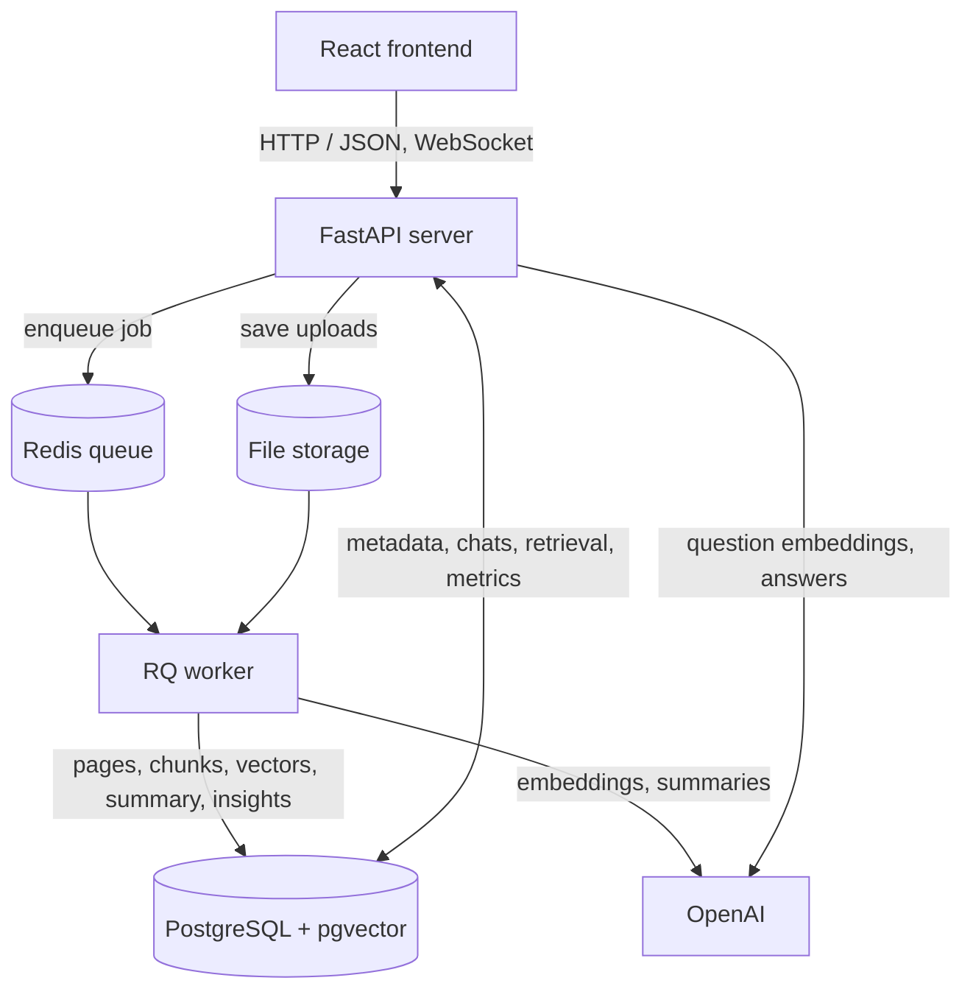

# AI Vault

A local document vault with AI built in. Upload PDFs and images, then search, read, compare and chat with your documents; every answer cites the page it came from.

More detail: [API reference](docs/api.md) · [Architecture](docs/architecture.md) · [Operations](docs/operations.md) · [How AI tools were used to build it](AI_USAGE.md)

## What it does

- **Upload** PDF, PNG or JPG (up to 10 MB). Processing runs in the background: text extraction, chunking, embeddings. Scans and photos are read page by page by a vision model.
- **Chat** with one document or several (2 to 10). Answers stream in, cite the page and quoted passage, and keep follow-up context. Conversations are saved; the last question can be edited.
- **Understand** each document automatically: summary, key insights with page evidence, category and title. Customize a summary by length, tone and focus.
- **Compare** 2 to 5 documents (similarities and differences by topic). Suggested starter questions per document.
- **Organize**: search by title, file name or category, document versions, rename, delete.
- **Observe**: live status updates over WebSocket, document statistics, processing metrics, AI token usage and estimated cost, API latency, health checks, JSON logs, rate limits.

Built with Python 3.12, FastAPI, SQLAlchemy, PostgreSQL + pgvector, Redis + RQ, LlamaIndex and OpenAI. The frontend is React, Vite and Tailwind CSS in plain JavaScript.

<hr>

## Quick start

You need Docker, Python 3.12 and Node.js 24 (what CI uses).

**1. Configure.** Copy `.env.example` to `.env` and set `POSTGRES_PASSWORD` and `OPENAI_API_KEY`. Keep `.env` out of Git.

**2. Start the database and Redis.**

```bash
docker compose up -d --wait
```

**3. Start the API** (from `backend/`).

```bash
cd backend
python3.12 -m venv .venv
source .venv/bin/activate
python -m pip install -r requirements-dev.txt
python -m alembic upgrade head
python -m uvicorn app.main:app --host 127.0.0.1 --port 8000
```

**4. Start the worker** in a second terminal (same folder, same virtual environment). Without it, uploads stay `queued`.

```bash
python -m app.worker
```

**5. Start the frontend** in a third terminal.

```bash
cd frontend
npm ci
npm run dev
```

Open the app at http://localhost:5173. The API docs (Swagger) are at http://localhost:8000/docs.

Without an `OPENAI_API_KEY`, extraction still works but documents stop at **Text extracted**: chat, search, summaries and insights need the embeddings a key enables. These features send document text to OpenAI and can incur charges. Other settings are in [docs/operations.md](docs/operations.md).

<hr>

## Project structure

```text
ai-vault/
├── backend/
│   ├── app/
│   │   ├── api/routes/     HTTP endpoints (validation only)
│   │   ├── services/       Workflows: documents, search, chat, content, metrics
│   │   ├── ai/             OpenAI calls, prompts and output validation
│   │   ├── processing/     PDF and image reading, chunking
│   │   ├── tasks/          Background job and its transactions
│   │   ├── db/             Models, queries, pgvector store
│   │   ├── schemas/        Request and response models
│   │   ├── core/           Config, logging, pricing, errors
│   │   ├── cli/            Manual recovery command
│   │   ├── main.py         API entry point
│   │   └── worker.py       Worker entry point
│   ├── migrations/         Alembic migrations
│   └── tests/
├── frontend/
│   └── src/
│       ├── app/            App shell
│       ├── features/       documents/, health/, overview/
│       ├── components/     Button, Tabs, Working
│       └── lib/            api, format, liveUpdates, useResource
├── docs/                   api.md, architecture.md, operations.md
├── storage/                Uploaded files (not in Git)
├── compose.yaml            PostgreSQL + pgvector and Redis
├── AI_USAGE.md
└── README.md
```

<hr>

## How it works



**Upload.** The API validates and stores the file, records it as `queued` and returns at once. A worker then processes it (see [Background processing](#background-processing)).

**Chat.** The question is embedded and the closest chunks are retrieved with pgvector. The model answers only from them and marks each fact with a label like `[1]`. The server then attaches the real page number and quoted text for each label and rejects labels that do not exist, so a citation cannot be invented. If the sources do not support an answer, the model says so instead of guessing.

The principle throughout: **the model produces judgments, the server produces facts.** More in [docs/architecture.md](docs/architecture.md).

<hr>

## API routes

Every endpoint is listed here. Request and response details are in [docs/api.md](docs/api.md), and Swagger is at `/docs`. Routes marked **(AI)** send document text to OpenAI and are rate limited.

1. **Documents**

   | Method | Route                       | What it does                                                                |
   | ------ | --------------------------- | --------------------------------------------------------------------------- |
   | POST   | `/documents`                | Upload one file and start background processing                             |
   | GET    | `/documents`                | List documents (latest versions); `q` searches title, file name or category |
   | GET    | `/documents/{id}`           | Metadata and status                                                         |
   | PATCH  | `/documents/{id}`           | Rename (a blank title shows the file name again)                            |
   | DELETE | `/documents/{id}`           | Delete permanently; `all_versions=true` removes every version               |
   | POST   | `/documents/{id}/reprocess` | Queue processing again for a failed, extracted or stuck document            |
   | POST   | `/documents/{id}/versions`  | Upload the next version of a document                                       |
   | GET    | `/documents/{id}/versions`  | List every version, newest first                                            |

2. **Generated content**

   | Method   | Route                                 | What it does                                                          |
   | -------- | ------------------------------------- | --------------------------------------------------------------------- |
   | POST/GET | `/documents/{id}/summary`             | Generate and save the summary (AI) / read it                          |
   | POST     | `/documents/{id}/summary/custom`      | Summary with chosen length, tone and focus; not saved (AI)            |
   | POST/GET | `/documents/{id}/insights`            | Generate and save 3 to 5 insights with page evidence (AI) / read them |
   | POST/GET | `/documents/{id}/classification`      | Generate and save category and title (AI) / read them                 |
   | POST     | `/documents/{id}/suggested-questions` | 3 to 4 starter questions (AI)                                         |

3. **Search and questions**

   | Method | Route                    | What it does                                         |
   | ------ | ------------------------ | ---------------------------------------------------- |
   | POST   | `/documents/{id}/search` | The closest chunks for a question, with page numbers |
   | POST   | `/documents/{id}/ask`    | One cited answer, nothing saved (AI)                 |

4. **Conversations**

   | Method | Route                                 | What it does                                                      |
   | ------ | ------------------------------------- | ----------------------------------------------------------------- |
   | POST   | `/documents/{id}/conversations`       | Start a conversation about one document                           |
   | GET    | `/documents/{id}/conversations`       | List its conversations                                            |
   | POST   | `/multi-conversations`                | Start a conversation across 2 to 10 documents                     |
   | GET    | `/multi-conversations`                | List multi-document conversations                                 |
   | GET    | `/conversations/{id}`                 | The saved turns, with citations                                   |
   | POST   | `/conversations/{id}/messages`        | Ask a question; optional `replace_turn` edits an earlier one (AI) |
   | POST   | `/conversations/{id}/messages/stream` | The same, streamed as server-sent events (AI)                     |

5. **Comparison**

   | Method | Route          | What it does                                                |
   | ------ | -------------- | ----------------------------------------------------------- |
   | POST   | `/comparisons` | Compare 2 to 5 documents: similarities and differences (AI) |

6. **Statistics, metrics and health**

   | Method | Route                 | What it does                                         |
   | ------ | --------------------- | ---------------------------------------------------- |
   | GET    | `/stats/documents`    | Documents by status, storage, pages, chunks, vectors |
   | GET    | `/metrics/processing` | Processing success rate and durations                |
   | GET    | `/metrics/ai-usage`   | Tokens and estimated cost per model                  |
   | GET    | `/metrics/api`        | Per-route request counts and latency                 |
   | GET    | `/health`             | The API is up                                        |
   | GET    | `/health/db`          | The database answers                                 |
   | GET    | `/health/queue`       | Redis is reachable and a worker is listening         |

7. **Live updates**

   | Method    | Route        | What it does                                              |
   | --------- | ------------ | --------------------------------------------------------- |
   | WebSocket | `/ws/events` | Pushes document status, content, rename and delete events |

<hr>

## Background processing

A worker (`python -m app.worker`) runs these steps for every upload. Each is a short stage, so a failure never loses earlier work.

1. **Claim.** One conditional update moves the document to `processing` and records an attempt. A duplicate job finds it claimed and skips.
2. **Read.** Text is extracted page by page; a scan or photo is transcribed by a vision model.
3. **Chunk.** The text is split into chunks of up to 200 words that never cross a page, and saved. With embeddings off, the document stops here as `extracted`.
4. **Embed.** Chunks are embedded in batches of 64. The vectors and the status `embedded` (shown as **Search ready**) are saved together.
5. **Generate.** Summary, insights, category and title, each best effort. This can never fail the document.

If a step fails, the document becomes `failed` with a readable reason and keeps the text already extracted. **Process again** (or `POST /documents/{id}/reprocess`) queues it again, and a document stuck because a worker died is recovered automatically after 10 minutes. Details in [docs/operations.md](docs/operations.md#processing-and-recovery).

**Statuses:** `queued` → `processing` → `embedded` (or `extracted` without embeddings) or `failed`.

<hr>

## Database

PostgreSQL with the pgvector extension. `backend/app/db/models.py` defines the schema and `backend/migrations/` is its history.

1. **PostgreSQL**

   - **documents**: one row per uploaded file (each version is its own row)

     | Field           | Type         | Null | Key | Default | Notes                                                              |
     | --------------- | ------------ | ---- | --- | ------- | ------------------------------------------------------------------ |
     | id              | uuid         | NO   | PRI | uuid4   |                                                                    |
     | filename        | varchar(255) | NO   |     |         |                                                                    |
     | title           | varchar(200) | YES  |     | NULL    | Shown instead of the file name                                     |
     | title_source    | varchar(10)  | YES  |     | NULL    | `ai` or `user`; a person's title always wins                       |
     | storage_path    | text         | NO   | UNI |         | Generated name under `storage/documents/`                          |
     | content_type    | varchar(100) | NO   |     |         |                                                                    |
     | size_bytes      | int          | NO   |     |         | Greater than 0                                                     |
     | group_id        | uuid         | NO   | MUL |         | Shared by all versions; the first version's id                     |
     | version_number  | int          | NO   |     | 1       | Unique within a group                                              |
     | is_latest       | boolean      | NO   |     | true    |                                                                    |
     | content_hash    | varchar(64)  | YES  |     | NULL    | Rejects an identical re-upload                                     |
     | status          | varchar(20)  | NO   |     | queued  | `queued`, `processing`, `extracted`, `embedded`, `ready`, `failed` |
     | extracted_pages | jsonb        | YES  |     | NULL    | Text per page                                                      |
     | summary         | text         | YES  |     | NULL    |                                                                    |
     | insights        | jsonb        | YES  |     | NULL    | Takeaways with page and quote                                      |
     | category        | varchar(40)  | YES  |     | NULL    |                                                                    |
     | error_message   | text         | YES  |     | NULL    | Why processing failed                                              |
     | created_at      | timestamptz  | NO   |     | now()   |                                                                    |

   - **document_chunks**: the searchable pieces of a document

     | Field           | Type         | Null | Key | Default | Notes                                      |
     | --------------- | ------------ | ---- | --- | ------- | ------------------------------------------ |
     | id              | uuid         | NO   | PRI | uuid4   |                                            |
     | document_id     | uuid         | NO   | MUL |         | Foreign key to `documents`, cascade delete |
     | chunk_index     | int          | NO   |     |         | Unique per document                        |
     | page_number     | int          | NO   |     |         | Greater than 0; every chunk is on one page |
     | text            | text         | NO   |     |         |                                            |
     | embedding       | vector(1536) | YES  |     | NULL    | Set together with `embedding_model`        |
     | embedding_model | varchar(100) | YES  |     | NULL    |                                            |

   - **conversations**: a saved chat

     | Field       | Type        | Null | Key | Default | Notes                                                  |
     | ----------- | ----------- | ---- | --- | ------- | ------------------------------------------------------ |
     | id          | uuid        | NO   | PRI | uuid4   |                                                        |
     | document_id | uuid        | YES  | MUL | NULL    | Set for one document; `NULL` for a multi-document chat |
     | turn_count  | int         | NO   |     | 0       | Guards against two simultaneous messages               |
     | created_at  | timestamptz | NO   |     | now()   |                                                        |

   - **conversation_turns**: one question and answer

     | Field           | Type        | Null | Key | Default | Notes                                               |
     | --------------- | ----------- | ---- | --- | ------- | --------------------------------------------------- |
     | id              | uuid        | NO   | PRI | uuid4   |                                                     |
     | conversation_id | uuid        | NO   | MUL |         | Foreign key to `conversations`, cascade delete      |
     | turn_number     | int         | NO   |     |         | Unique per conversation, starts at 1                |
     | response        | jsonb       | NO   |     |         | Question, answer, citation snapshots, model, tokens |
     | created_at      | timestamptz | NO   |     | now()   |                                                     |

   - **conversation_documents**: which documents a multi-document chat covers

     | Field           | Type | Null | Key | Default | Notes                                   |
     | --------------- | ---- | ---- | --- | ------- | --------------------------------------- |
     | conversation_id | uuid | NO   | PRI |         | Foreign key to `conversations`, cascade |
     | document_id     | uuid | NO   | PRI |         | Foreign key to `documents`, cascade     |

   - **processing_attempts**: one row per processing run

     | Field                  | Type        | Null | Key | Default    | Notes                               |
     | ---------------------- | ----------- | ---- | --- | ---------- | ----------------------------------- |
     | id                     | uuid        | NO   | PRI | uuid4      |                                     |
     | document_id            | uuid        | NO   | MUL |            | Foreign key to `documents`, cascade |
     | status                 | varchar(20) | NO   |     | processing | `processing`, `succeeded`, `failed` |
     | started_at             | timestamptz | NO   |     | now()      |                                     |
     | finished_at            | timestamptz | YES  |     | NULL       | Set once the run ends               |
     | duration_ms            | int         | YES  |     | NULL       |                                     |
     | embedding_input_tokens | int         | NO   |     | 0          |                                     |
     | error_message          | text        | YES  |     | NULL       |                                     |

2. **Redis** (no schema): the job queue, cached query embeddings and generated content, rate-limit counters, and the `vault:events` channel behind live updates.

<hr>

## Design decisions

| Decision                                                    | Why                                                                                                                                                         |
| ----------------------------------------------------------- | ----------------------------------------------------------------------------------------------------------------------------------------------------------- |
| **LlamaIndex** for chunking, embedding and retrieval        | Document Q&A is what it is built for. Our own table and OpenAI helper sit underneath, so migrations, cascade deletes and exact token counts keep working.   |
| **OpenAI SDK directly** for answers, summaries and insights | Strict structured output, citation retries and streaming are tested against the SDK. LlamaIndex's OpenAI package needs an older SDK than this project pins. |
| **PostgreSQL + pgvector**                                   | One store for metadata, chats and vectors, written in the same transactions.                                                                                |
| **RQ + Redis**, not Celery                                  | Smaller, and enough for one queue with retries and status.                                                                                                  |
| **Page-bounded chunks** (up to 200 words, 40 overlap)       | Every citation has a precise page.                                                                                                                          |
| **Server-built citations**                                  | The model writes `[n]` labels only; page and quote come from stored chunks.                                                                                 |
| **Follow-ups without a rewrite call**                       | Retrieval searches the bare question and the question with the previous turn, then fuses the two rankings. No extra model call.                             |
| **Chat uses `gpt-4.1`**, other generation `gpt-4.1-mini`    | A wrong detail does the most harm in an answer. Change with `CHAT_MODEL`.                                                                                   |
| **Failures are isolated**                                   | A failed embedding keeps the extracted text; a failed summary keeps the document searchable.                                                                |
| **Rate limits per client IP**, failing open                 | Protects the endpoints that spend money; a Redis outage does not take the API down.                                                                         |

<hr>

## Assumptions and limits

- **Single tenant, no login.** Anyone who can reach the API sees and can delete every document. Deletion is permanent.
- PDF, PNG and JPG only, up to 10 MB. No DOCX. Scanned PDFs are limited to 10 pages (`OCR_MAX_PAGES`), and handwriting or complex tables can be misread. Summaries and insights read at most 60,000 characters.
- Written for English documents and a local setup (Docker services, local disk, OpenAI as the provider).
- Token usage for summaries, insights and one-shot `/ask` is logged but not stored, so `GET /metrics/ai-usage` undercounts spend.
- Answer quality was checked by tests and manual trials, not an automated evaluation set.
- Hosted use would need HTTPS, a trusted-proxy policy for client IPs, secrets management and backups.

<hr>

## Scaling to thousands of documents

Not load-tested; this is how the design should behave and what would change.

- **Ingestion** scales by running more workers: claiming a document is atomic and abandoned jobs are recovered. Uploads return immediately, and embeddings are batched.
- **Search** is filtered to the chosen documents (at most 10), so only their vectors are compared and no vector index is needed yet. Searching the whole library at once would need an HNSW index.
- **Reads** are paginated and skip large text columns. At very large scale, cache the statistics and move page text out of the document row.
- **Cost** is bounded by batching, saved summaries and insights, cached query embeddings, output caps, rate limits and a daily quota.
- **Storage** is behind one save function; S3-compatible storage would replace local disk for several API hosts.

<hr>

## Tests

```bash
# backend, from backend/ with the virtual environment active
python -m ruff check . && python -m ruff format --check .
python -m pytest
RUN_INTEGRATION_TESTS=1 python -m pytest   # also runs the database tests
python -m alembic check

# frontend, from frontend/
npm run lint && npm run format:check && npm test && npm run build
```

Tests never call the paid provider. GitHub Actions runs all of this on every push, with PostgreSQL/pgvector and Redis for the backend.
