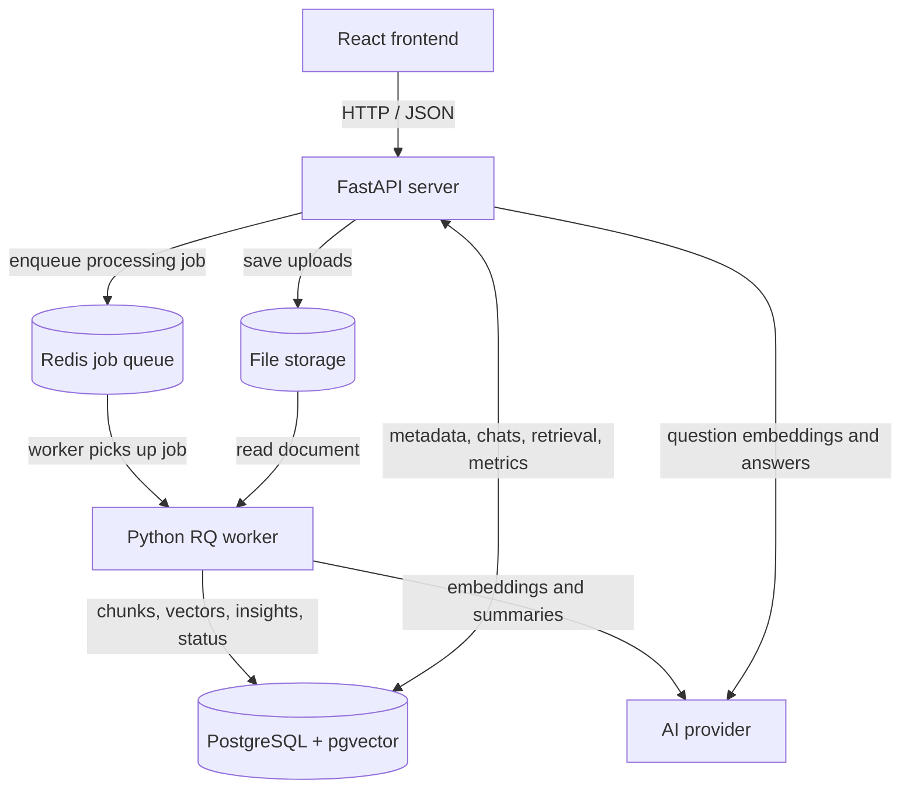

# AI Vault

How AI tools were used to build this is described in [AI_USAGE.md](AI_USAGE.md).

A local document vault with PDF and image uploads (scans and photos are read with the vision model), background text extraction, semantic search, source-cited answers (chat with one document or across several), saved conversations, customizable summaries, insights, automatic category and title, search by title, file name or category, document versions, comparative analysis, live status updates over WebSocket, and processing metrics.

Built with Python 3.12, FastAPI, SQLAlchemy, PostgreSQL + pgvector, Redis/RQ, and OpenAI. A React frontend (plain JavaScript, Vite and Tailwind CSS) covers the whole workflow: upload, search, read, chat, compare and manage documents.

## Run locally

Start Docker Desktop. From the repository root, create `.env` from `.env.example` if it does not exist and set `POSTGRES_PASSWORD`. Keep `.env` out of Git.

```bash
docker compose up -d --wait
cd backend
python3.12 -m venv .venv
source .venv/bin/activate
python -m pip install -r requirements-dev.txt
python -m alembic upgrade head
python -m uvicorn app.main:app --host 127.0.0.1 --port 8000
```

In a second terminal, from `backend/` with the same virtual environment active:

```bash
python -m app.worker
```

Open [Swagger](http://localhost:8000/docs), [health](http://localhost:8000/health), [database health](http://localhost:8000/health/db), or [queue health](http://localhost:8000/health/queue) (shows whether a worker is running). PostgreSQL binds to localhost:5433 and Redis to localhost:6379.

Set `OPENAI_API_KEY` in the root `.env` before starting the API and worker: with a key present, uploads are embedded automatically and documents reach **Search ready**, which chat, search, summaries, and insights need. Without a key, extraction still works and documents stop at **Text extracted**. Set `ENABLE_EMBEDDINGS=false` to force extraction-only even when a key exists. After embedding, the worker also generates a summary and key insights automatically (set `AUTO_GENERATE_CONTENT=false` to turn that off); if that step fails the document stays searchable and you can generate them on demand. These features send document text to the provider and can incur charges.

## Frontend workspace

In another terminal, from the repository root (Node.js 24 is used in CI):

```bash
cd frontend
npm ci
npm run dev
```

Open [the frontend](http://localhost:5173). The Python server must be running on port 8000 (the dev server proxies `/api` to it).

- **Upload and browse.** Choose a PDF, PNG or JPG up to 10 MB and select **Upload**. A PDF with no text layer (a scan, or "Microsoft Print to PDF") and any picture are read page by page as images; a failed document says why in its details. The list shows a readable title, size, upload time and status, with pagination and a search box above the list (matches title, file name or category as you type; **✕** or Escape clears it). Status changes arrive without refreshing (WebSocket, reconnecting automatically); the refresh icon reloads on demand. A notice appears if no background worker is running, since uploads would stay queued. Uploading, deleting and **Process again** show their result at once (a pending row, a vanished row, a **Queued** badge) and roll back with a message if the server refuses.
- **Titles.** Documents are listed by a readable title: one the AI writes from the content (in the same request that picks the category, so no extra cost) or one you set with **Rename** in the document dialog. Your own title always wins and applies to every version; clearing it shows the file name, tidied, again.
- **Chat, always on the right.** The screen is a library on the left and one chat on the right. What the chat asks follows the library: tick documents to ask just those (1 document is its own saved conversation, restored when you come back; 2 to 10 is one conversation across them, with each source naming its document and page), or tick none to ask every search-ready document (the newest ten). Chips above the thread always say what is being asked, with **Use all documents** to go back and **Compare** (2 to 5 documents: similarities and differences by topic, with an optional focus). Answers stream in, cite the page they came from, the last question can be edited and resent (it replaces that answer), and the bar above the thread has a **New chat** button; Enter sends and Shift+Enter adds a line. Until a document is search ready the chat says how many are still processing. On a narrow screen a **Chat | Documents** switch shows one pane at a time.
- **Open a document** by selecting its title. The dialog has the title, **Rename**, the status (a short hint appears only while the document is not ready to use) and **Ask about this document**, which points the chat at it. **Summary** (the default for search-ready documents) has the saved summary (or **Generate summary**), **Customize the summary** (length, tone, focus; the result replaces the summary on screen with a way back, is not saved, and is cached for repeats) and **insights** with page evidence. **Details** (the default while a document is processing or failed) has the category (or **Add category** for an older document that has none), file name, size and upload time, **Versions** (upload a new version; the list appears once there are two or more, with a `v2` badge for revisions) and **Manage**: **Process again** for failed or text-only documents, and permanent **Delete** with a confirmation. Close with the ✕ or press Escape.
- **Metrics.** The **Metrics** button in the header opens document statistics and processing metrics; nothing is read until it is opened.
- **Cost.** Listing, health checks and viewing saved content do not call the AI provider. Questions, generating or customizing summaries and insights, comparing, and processing uploads (embeddings) do, and may incur charges.

Frontend code is grouped under `src/app`, `src/features`, `src/components`, `src/hooks`, and `src/lib`. Requests, validation, loading state, and presentation have separate modules. Lint, formatting, API contract tests, and build checks are enabled. See the [frontend guide](frontend/README.md) for commands and proxy behavior. Production API routing is not configured yet.

## Code structure

```text
backend/
  app/
    api/routes/       HTTP validation and endpoint declarations
    services/         Document, search, chat, content and analytics workflows
    ai/               Provider adapters, prompts and output validation
    processing/       PDF extraction and text chunking
    tasks/            Redis queue and background processing orchestration
    db/               SQLAlchemy engine, models and shared lookups
    schemas/          Request/response models grouped by feature
    core/             Configuration, shared constants and service errors
    cli/              Manual enqueue and recovery commands
    main.py           Application construction and resource lifecycle
    worker.py         Worker entry point
  migrations/         Versioned database changes
  tests/              Unit, HTTP, architecture and database integration tests
frontend/
  src/app/           Application layout
  src/features/      UI and API contracts grouped by feature
  src/lib/           Shared frontend request helpers
docs/
  architecture.md     Boundaries, transaction design and extension guide
  api.md              Endpoint behavior, operations and current limitations
```

Routes delegate to services. Services coordinate database access and provider adapters; they do not import FastAPI. AI adapters do not access the database. The worker reuses processing and AI helpers and owns its transaction boundaries. Applied migrations are preserved.

## Main endpoints

| Workflow | Endpoint |
| --- | --- |
| Upload/list/get | `POST /documents`, `GET /documents`, `GET /documents/{id}` |
| Retry processing | `POST /documents/{id}/reprocess` |
| Delete | `DELETE /documents/{id}` (`?all_versions=true` removes every version) |
| Health | `GET /health`, `GET /health/db`, `GET /health/queue` (Redis and whether a worker is running) |
| Semantic search | `POST /documents/{id}/search` |
| One question with citations | `POST /documents/{id}/ask` |
| Real-time updates | `WS /ws/events` (status changes pushed from the worker through Redis) |
| Comparative analysis | `POST /comparisons` (2–5 documents, optional focus) |
| Multi-document chat | `POST` / `GET /multi-conversations` (then the same message endpoints as below) |
| Saved conversations | `POST` / `GET /documents/{id}/conversations`, `POST /conversations/{id}/messages`, `POST /conversations/{id}/messages/stream` (SSE), `GET /conversations/{id}` |
| Saved summaries | `POST` / `GET /documents/{id}/summary` |
| Custom summaries (length, tone, focus) | `POST /documents/{id}/summary/custom` |
| Versions of a document | `POST` / `GET /documents/{id}/versions` |
| Category and AI title, search | `POST` / `GET /documents/{id}/classification`, `GET /documents?q=` |
| Rename a document | `PATCH /documents/{id}` with `{"title": "..."}` (`null` shows the file name again) |
| Saved insights | `POST` / `GET /documents/{id}/insights` |
| Suggested starter questions | `POST /documents/{id}/suggested-questions` |
| Document statistics | `GET /stats/documents` |
| Processing metrics | `GET /metrics/processing` |
| AI token usage and estimated cost | `GET /metrics/ai-usage` |
| API request latency per route | `GET /metrics/api` |

See [API and operations](docs/api.md) for request examples, status/error behavior, caching, limits, and recovery commands.

## Architecture



**Upload:** the API validates and stores the file, records it as `queued`, and returns immediately (HTTP 201). A worker then extracts text with page numbers (a PDF with no text, or a picture, is drawn to JPEG pages and read by the vision model instead, up to `OCR_MAX_PAGES`, default 10), chunks it, embeds the chunks, and finally generates a summary and key insights. Status moves `queued, processing, extracted, embedded` (or `failed` with a readable error).

**Chat:** a question is embedded, the closest chunks of that document are retrieved with pgvector, and the model answers only from them. Citations carry the real page number and quoted text, and are validated before they are returned. Follow-ups use the latest three turns as context. Answers come from `gpt-4.1` by default (`CHAT_MODEL`), because a wrong detail does the most harm there.

See [docs/architecture.md](docs/architecture.md) for transaction boundaries and [docs/api.md](docs/api.md) for every endpoint.

## Design decisions and assumptions

| Decision | Why | Trade-off |
| --- | --- | --- |
| LlamaIndex for ingestion and retrieval, over LangChain | Document Q&A is what LlamaIndex is built around (documents, splitters, indexes, retrievers). LangChain's strengths, chains and agents, are not used here. LlamaIndex splits pages (`SentenceSplitter`), drives batching through a custom embed model, and retrieves through `VectorStoreIndex` and a metadata-filtered retriever | The framework sits on top of our own pieces: a custom vector store over the existing `document_chunks` table (migrations, cascade delete and statistics keep working), and a custom embed model that reuses our OpenAI helper for exact token counts and retries |
| OpenAI SDK for answers, summaries and insights | `llama-index-llms-openai` requires `openai<3`, and this project pins `openai==3.43.0`. Answers also need strict structured output, a citation retry and streaming, all of which are tested against the SDK directly | LlamaIndex's query engines and LLM classes are not used; moving to them means downgrading the SDK and re-verifying citations |
| PostgreSQL + pgvector for vectors | One store for metadata, chats and vectors, written in the same transactions | Not specialised for huge vector workloads; fine for per-document search |
| RQ + Redis instead of Celery | Smaller surface, enough for retries, status and a single queue | Fewer built-in scheduling features |
| Page-bounded chunks of up to 200 words with about 40 overlap, split on sentence boundaries | A chunk belongs to exactly one page, so every citation has a precise page; sentence boundaries keep passages readable | Text spanning a page break is split; word counts are not token counts |
| Top 8 chunks for one document; for several, the closest 12 with repeated passages dropped, and for "each / every / compare / in common" questions the 2 best passages of every document; no distance cutoff | Lists and longer explanations need more than a few passages, and a few documents must not fill every slot; the model abstains via `insufficient_evidence` | A reranker or keyword search could improve borderline questions; prompts are larger (about 2–5k tokens) |
| The `[n]` labels written in the answer pick the sources; the server attaches page and quote | Citations cannot be hallucinated | Checks that a source exists, not that every claim follows from it |
| Follow-ups: last 3 turns go to the model; retrieval searches the bare question and the question with the previous turn, then fuses the two rankings | No extra rewrite call (cost and latency), and a change of subject is not pulled back to the old one | Very old references retrieve poorly |
| Summaries and insights saved on the document, generated automatically after embedding | Repeat views cost nothing and users see results without clicking | Their token usage is logged but not stored in the database |
| A conversation covers one document, or a chosen set of 2 to 10 | Retrieval is filtered to exactly those documents and every source names its document, so citations stay unambiguous | The set is fixed when the conversation starts; deleting a document deletes the multi-document conversations that included it |
| Failures are isolated | Embedding failure keeps the extracted text; generation failure keeps the document searchable; a Redis outage does not break the limiter or reads | More states to reason about, covered by tests |
| Rate limits per client IP, failing open | Protects the endpoints that spend money without accounts | Shared IPs share limits; a Redis outage disables limiting |

**Assumptions**

- Single tenant, no authentication: every client sees every document. Conversation and document IDs are unguessable UUIDs, which is not access control.
- PDF, PNG and JPG files up to 10 MiB. PDFs with a text layer are read locally for free; scans and pictures are read by the vision model (one paid request per page, at most 10 pages per scanned PDF) and are sent to the AI provider. Encrypted PDFs are rejected with a clear message. DOCX is not supported.
- Local deployment (Docker for PostgreSQL and Redis, local disk for files), OpenAI as the provider, and acceptance that document text is sent to it.
- English-language documents; the prompts and word-based chunking were not tuned for other languages.

## Scaling to thousands of documents

This has not been load-tested; the following is how the design is expected to behave and what I would change.

- **Ingestion.** Uploads return as soon as the file is stored and a job is queued, so request time does not grow with document size. Add throughput by running more `python -m app.worker` processes: claiming a document is atomic, duplicate jobs are skipped, and a dead worker's documents are recovered when a worker next starts. Embeddings are sent in batches of 64 chunks to limit round trips and cost.
- **Search.** Retrieval is filtered to the chosen document or documents (at most 10 per question), so the database compares only their few hundred vectors each and no vector index is needed yet. Searching the whole library at once would need an HNSW index on the embedding column.
- **Reads.** Lists are paginated, large text columns are not loaded for metadata queries, and statistics are single aggregate queries. At very large scale I would cache or pre-aggregate the statistics and move extracted page text out of the document row.
- **Caching.** Summaries and insights are generated once and reused. Query embeddings are cached in Redis for 24 hours, keyed by a hash of the normalised question plus the model, so repeated or retried questions skip the embedding call. Answers are deliberately not cached: they depend on conversation history and cost more to get wrong.
- **Cost control.** Small model, output caps, batching, per-IP rate limits and a daily quota, plus `GET /metrics/ai-usage` for estimated spend.
- **Storage.** Local disk is behind a single save path; S3-compatible storage would replace it for multiple API hosts.

## Known limitations

- No authentication or per-user isolation, so anyone who can reach the API can read or delete any document. Deletion is permanent (no trash or undo).
- PDF, PNG and JPG only (no DOCX or plain text). Scanned pages are read by a vision model, so handwriting, small print and complex tables can be misread, and scanned PDFs over 10 pages are refused. 60,000-character limit for summaries and insights.
- Summaries and insights are not streamed; only chat answers are.
- Token usage for summaries, insights and stateless `/ask` is logged but not stored, so `/metrics/ai-usage` undercounts spend. It is also computed from stored chats and processing attempts, so deleting a document removes its tokens from the totals.
- Answer quality is checked by tests and manual trials, not by an automated evaluation set.
- Hosted production would need HTTPS, a proxy-aware client-IP policy, secrets management, and database backups.

## Development checks

From `backend/` with `.venv` active:

```bash
python -m ruff check .
python -m ruff format --check .
python -m pytest
RUN_INTEGRATION_TESTS=1 python -m pytest
python -m alembic check
```

Tests run with pytest (the suite is written with `unittest` classes and `pytest` collects them; `python -m unittest discover -s tests` also works). Database integration tests require local PostgreSQL with migrations applied and use their own records or temporary tables. Tests mock paid provider requests. GitHub Actions runs formatting, lint, migration replay and the complete test suite against PostgreSQL/pgvector and Redis. To format an edit, run `python -m ruff format .`.

To recover a saved queued/failed upload from the command line (the web UI's **Process again** and `POST /documents/{id}/reprocess` do the same):

```bash
python -m app.cli.enqueue_document DOCUMENT_UUID
python -m app.worker --burst
```

Drain old queued work before updating from the former flat module layout; newly enqueued jobs use the `app.tasks.documents` import path. CLI commands and the server now run as package modules. The database, stored files, and existing API request/response shapes stay compatible.

Stop services with `docker compose stop` from the repository root. `docker compose down -v` deletes local database and Redis volumes.
