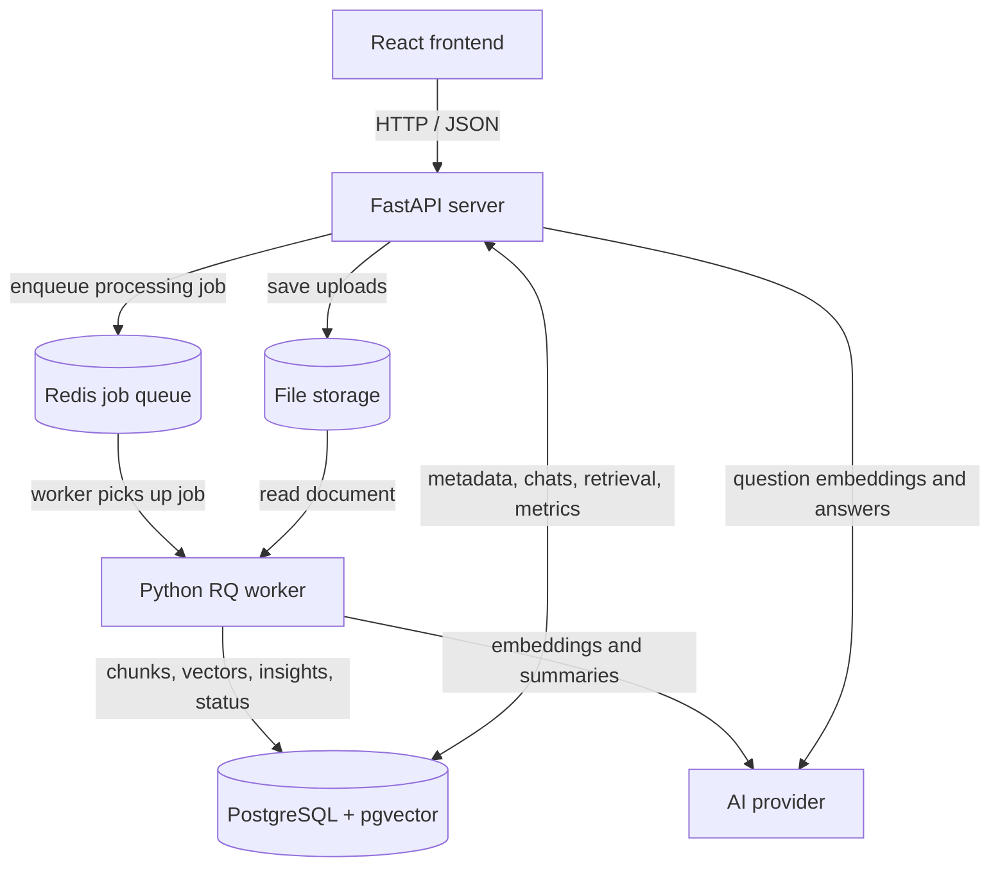

# AI Vault

How AI tools were used to build this is described in [AI_USAGE.md](AI_USAGE.md).

A local document vault with PDF uploads, background text extraction, semantic search, source-cited answers, saved conversations, summaries, insights, and processing metrics.

Built with Python 3.12, FastAPI, SQLAlchemy, PostgreSQL + pgvector, Redis/RQ, and OpenAI. A React/TypeScript frontend styled with Tailwind CSS uploads PDFs, lists documents with processing status and pagination, and verifies the backend connection.

## Run locally

Start Docker Desktop. From the repository root, create `.env` from `.env.example` if it does not exist and set `POSTGRES_PASSWORD`. Keep `.env` out of Git.

```bash
docker compose up -d --wait
cd backend
python3.12 -m venv .venv
source .venv/bin/activate
python -m pip install -r requirements-dev.txt
python -m alembic upgrade head
python -m uvicorn app.main:app --host 127.0.0.1 --port 8000
```

In a second terminal, from `backend/` with the same virtual environment active:

```bash
python -m app.worker
```

Open [Swagger](http://localhost:8000/docs), [health](http://localhost:8000/health), or [database health](http://localhost:8000/health/db). PostgreSQL binds to localhost:5433 and Redis to localhost:6379.

Set `OPENAI_API_KEY` in the root `.env` before starting the API and worker: with a key present, uploads are embedded automatically and documents reach **Search ready**, which chat, search, summaries, and insights need. Without a key, extraction still works and documents stop at **Text extracted**. Set `ENABLE_EMBEDDINGS=false` to force extraction-only even when a key exists. After embedding, the worker also generates a summary and key insights automatically (set `AUTO_GENERATE_CONTENT=false` to turn that off); if that step fails the document stays searchable and you can generate them on demand. These features send document text to the provider and can incur charges.

## Frontend workspace

In another terminal, from the repository root (Node.js 24 is used in CI):

```bash
cd frontend
npm ci
npm run dev
```

Open [the frontend](http://localhost:5173). Choose a PDF up to 10 MB and select **Upload PDF**; the form saves it and refreshes the list. It lists documents with status, size, upload time, and pagination. **Refresh** reloads the list. Select a filename to see document details, read its saved summary and insights with page references and evidence, and refresh its processing status. Viewing summaries and insights reads saved content without calling the AI provider. If none exists, **Generate summary** or **Generate insights** creates and saves the result using AI when extracted text is available; API charges may apply. Generation blocks repeated submissions, and an unconfirmed request requires checking for a saved result before trying again. **Ask this document** holds a saved conversation for search-ready documents: ask a question, then follow-ups, with expandable sources and page citations for each answer. Questions use AI and may incur charges; the view clears when details close. Close or press Escape to return to the list. The **Workspace overview** below the list shows document statistics (counts, storage, pages, searchable chunks, status breakdown) and processing metrics (attempts, success rate, average and slowest time, embedding tokens); **Refresh overview** reloads both without calling the AI provider. Closing a document's details does not lose the chat: reopening it restores its latest conversation (**New conversation** starts a fresh one). Expand **Service connection** to check backend health. Listing documents and checking health do not use the AI API. Uploads queue background processing, which uses the AI API when embeddings are enabled. The Python server must be running on port 8000.

Frontend code is grouped under `src/app`, `src/features`, `src/components`, and `src/lib`. Requests, validation, loading state, and presentation have separate modules. TypeScript strict mode, lint, formatting, API contract tests, and build checks are enabled. See the [frontend guide](frontend/README.md) for commands and proxy behavior. Production API routing is not configured yet.

## Code structure

```text
backend/
  app/
    api/routes/       HTTP validation and endpoint declarations
    services/         Document, search, chat, content and analytics workflows
    ai/               Provider adapters, prompts and output validation
    processing/       PDF extraction and text chunking
    tasks/            Redis queue and background processing orchestration
    db/               SQLAlchemy engine, models and shared lookups
    schemas/          Request/response models grouped by feature
    core/             Configuration, shared constants and service errors
    cli/              Manual enqueue and learning utilities
    main.py           Application construction and resource lifecycle
    worker.py         Worker entry point
  migrations/         Versioned database changes
  tests/              Unit, HTTP, architecture and database integration tests
frontend/
  src/app/           Application layout
  src/features/      UI and API contracts grouped by feature
  src/lib/           Shared frontend request helpers
docs/
  architecture.md     Boundaries, transaction design and extension guide
  api.md              Endpoint behavior, operations and current limitations
  backend-review.md   Review findings, changes and verification
```

Routes delegate to services. Services coordinate database access and provider adapters; they do not import FastAPI. AI adapters do not access the database. The worker reuses processing and AI helpers and owns its transaction boundaries. Applied migrations are preserved.

## Main endpoints

| Workflow | Endpoint |
| --- | --- |
| Upload/list/get | `POST /documents`, `GET /documents`, `GET /documents/{id}` |
| Retry processing | `POST /documents/{id}/reprocess` |
| Semantic search | `POST /documents/{id}/search` |
| One question with citations | `POST /documents/{id}/ask` |
| Saved conversations | `POST` / `GET /documents/{id}/conversations`, `POST /conversations/{id}/messages`, `GET /conversations/{id}` |
| Saved summaries | `POST` / `GET /documents/{id}/summary` |
| Saved insights | `POST` / `GET /documents/{id}/insights` |
| Document statistics | `GET /stats/documents` |
| Processing metrics | `GET /metrics/processing` |
| AI token usage and estimated cost | `GET /metrics/ai-usage` |
| API request latency per route | `GET /metrics/api` |

See [API and operations](docs/api.md) for request examples, status/error behavior, caching, limits, and recovery commands.

## Architecture



**Upload:** the API validates and stores the PDF, records it as `queued`, and returns immediately (HTTP 201). A worker then extracts text with page numbers, chunks it, embeds the chunks, and finally generates a summary and key insights. Status moves `queued, processing, extracted, embedded` (or `failed` with a readable error).

**Chat:** a question is embedded, the closest chunks of that document are retrieved with pgvector, and the model answers only from them. Citations carry the real page number and quoted text, and are validated before they are returned. Follow-ups use the latest three turns as context.

See [docs/architecture.md](docs/architecture.md) for transaction boundaries and [docs/api.md](docs/api.md) for every endpoint.

## Design decisions and assumptions

| Decision | Why | Trade-off |
| --- | --- | --- |
| Hand-built RAG instead of LangChain or LlamaIndex | The pipeline is small and I wanted full control over citations, validation, and failure handling, with every step testable | No framework features (hybrid search, rerankers); I would adopt one for multi-document or multi-source retrieval |
| PostgreSQL + pgvector for vectors | One store for metadata, chats and vectors, written in the same transactions | Not specialised for huge vector workloads; fine for per-document search |
| RQ + Redis instead of Celery | Smaller surface, enough for retries, status and a single queue | Fewer built-in scheduling features |
| Page-bounded chunks of 200 words with 40 overlap | A chunk belongs to exactly one page, so every citation has a precise page | Text spanning a page break is split; word counts are not token counts |
| Top 3 chunks, no distance cutoff | Keeps prompts cheap; the model abstains via an explicit `insufficient_evidence` flag | A cutoff or reranker could improve borderline questions |
| Model returns source numbers only; the server attaches page and quote | Citations cannot be hallucinated | Checks that a source exists, not that every claim follows from it |
| Follow-ups: last 3 turns plus a short slice of the previous turn in the retrieval query | No extra rewrite call (cost and latency) | Very old references retrieve poorly |
| Summaries and insights saved on the document, generated automatically after embedding | Repeat views cost nothing and users see results without clicking | Their token usage is logged but not stored in the database |
| One conversation belongs to one document | Keeps retrieval and citations unambiguous | Multi-document chat is future work |
| Failures are isolated | Embedding failure keeps the extracted text; generation failure keeps the document searchable; a Redis outage does not break the limiter or reads | More states to reason about, covered by tests |
| Rate limits per client IP, failing open | Protects the endpoints that spend money without accounts | Shared IPs share limits; a Redis outage disables limiting |

**Assumptions**

- Single tenant, no authentication: every client sees every document. Conversation and document IDs are unguessable UUIDs, which is not access control.
- PDFs with selectable text up to 10 MiB. Scanned PDFs (no OCR) and encrypted PDFs are rejected with a clear message. DOCX is not supported.
- Local deployment (Docker for PostgreSQL and Redis, local disk for files), OpenAI as the provider, and acceptance that document text is sent to it.
- English-language documents; the prompts and word-based chunking were not tuned for other languages.

## Scaling to thousands of documents

This has not been load-tested; the following is how the design is expected to behave and what I would change.

- **Ingestion.** Uploads return as soon as the file is stored and a job is queued, so request time does not grow with document size. Add throughput by running more `python -m app.worker` processes: claiming a document is atomic, duplicate jobs are skipped, and a dead worker's documents are recovered automatically. Embeddings are sent in batches of 64 chunks to limit round trips and cost.
- **Search.** Retrieval is scoped to one document, so the database compares only that document's few hundred vectors and no vector index is needed yet. Cross-document search would need an HNSW index on the embedding column plus a metadata filter.
- **Reads.** Lists are paginated, large text columns are not loaded for metadata queries, and statistics are single aggregate queries. At very large scale I would cache or pre-aggregate the statistics and move extracted page text out of the document row.
- **Caching.** Summaries and insights are generated once and reused. Not yet cached: query embeddings and repeated answers, which I would key by a hash of the normalised question in Redis.
- **Cost control.** Small model, output caps, batching, per-IP rate limits and a daily quota, plus `GET /metrics/ai-usage` for estimated spend.
- **Storage.** Local disk is behind a single save path; S3-compatible storage would replace it for multiple API hosts.

## Known limitations

- No authentication or per-user isolation; no document deletion endpoint.
- PDF text only: no OCR, no DOCX, 60,000-character limit for summaries and insights.
- Not implemented: multi-document chat, streaming responses, document version tracking, follow-up suggestions, and WebSocket updates (the UI refreshes on demand).
- Token usage for summaries, insights and stateless `/ask` is logged but not stored, so `/metrics/ai-usage` undercounts spend.
- Answer quality is checked by tests and manual trials, not by an automated evaluation set.
- Hosted production would need HTTPS, a proxy-aware client-IP policy, secrets management, and database backups.

## Development checks

From `backend/` with `.venv` active:

```bash
python -m ruff check .
python -m ruff format --check .
python -m unittest discover -s tests -v
RUN_INTEGRATION_TESTS=1 python -m unittest discover -s tests -v
python -m alembic check
```

Database integration tests require local PostgreSQL with migrations applied and use their own records or temporary tables. Tests mock paid provider requests. GitHub Actions runs formatting, lint, migration replay and the complete test suite against PostgreSQL/pgvector and Redis. To format an edit, run `python -m ruff format .`.

For the queue demo or recovery of a saved queued/failed upload:

```bash
python -m app.cli.enqueue_demo
python -m app.cli.enqueue_document DOCUMENT_UUID
python -m app.worker --burst
```

Drain old queued work before updating from the former flat module layout; newly enqueued jobs use the `app.tasks.documents` import path. CLI commands and the server now run as package modules. The database, stored files, and existing API request/response shapes stay compatible.

Stop services with `docker compose stop` from the repository root. `docker compose down -v` deletes local database and Redis volumes.
